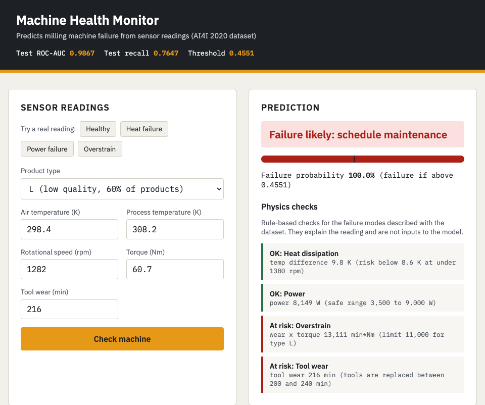

# Machine Failure Prediction with Docker: MLOps Docker Lab

This lab trains a TensorFlow/Keras model that predicts whether a milling machine
is about to fail from five sensor readings, and serves it as a Flask web app in
Docker. It can be built as one multi-stage image (train, then serve) or run as
two containers with Docker Compose.

> **Lab Assignment 2 submission.** Adapted from
> [Docker_Labs/Lab2](https://github.com/raminmohammadi/MLOps/tree/main/Labs/Docker_Labs/Lab2)
> in the [raminmohammadi/MLOps](https://github.com/raminmohammadi/MLOps) course
> repository. The structure is the same (training script, Flask app, multi-stage
> Dockerfile, docker-compose with a shared volume), and the dataset, problem,
> training and web page are new. See [My Modifications](#my-modifications).

---

## Dataset

The [AI4I 2020 Predictive Maintenance dataset](https://archive.ics.uci.edu/dataset/601/ai4i+2020+predictive+maintenance+dataset)
from the UCI Machine Learning Repository. It is not used in any of the course labs.

- 10,000 machine readings. Each has a product type (L, M or H quality) and five
  sensor values: air temperature, process temperature, rotational speed, torque
  and tool wear.
- The target is `Machine failure` (1 or 0). Only 339 rows (3.4%) are failures, so
  accuracy is not useful here: always predicting "no failure" scores 96.6%.
- Failures come from five modes: tool wear (TWF), heat dissipation (HDF), power
  (PWF), overstrain (OSF) and random (RNF). The mode columns are only known after
  a failure, so they are **not** used as inputs (that would leak the label). The ID
  columns `UDI` and `Product ID` are dropped too.
- The data is synthetic but modeled on real milling machines. 9 failures have no
  mode flag and 18 rows have a mode flag but no failure. These rows are kept as is.

The CSV is in `data/ai4i2020.csv`.

License: CC BY 4.0. Matzka, S. (2020). AI4I 2020 Predictive Maintenance Dataset.
UCI Machine Learning Repository. https://doi.org/10.24432/C5HS5C

---

## My Modifications

The original lab trains a small Keras model on Iris (150 rows, 4 features, 3
balanced classes) and shows a flower picture for the predicted species. In this
version:

- **Problem and dataset:** binary failure prediction on 10,000 imbalanced machine
  readings instead of Iris species.
- **Features:** three engineered features based on how the failures are defined
  in the dataset description: temperature difference (process minus air),
  mechanical power (torque x speed) and strain (tool wear x torque). The product
  type is one-hot encoded.
- **Shared feature code:** `src/features.py` builds the model input for both
  training and serving, so the two can't drift apart. Scaling is a Keras
  `Normalization` layer saved inside the model, so there is no separate scaler file.
- **Training and evaluation:** a stratified 70/15/15 train/validation/test split,
  early stopping on validation PR-AUC, and a decision threshold tuned on the
  validation set for the best F1 instead of 0.5. The report covers ROC-AUC, PR-AUC,
  precision, recall, F1, the confusion matrix and recall per failure mode. Everything
  is saved to `model/model_meta.json`.
- **Model choice:** I compared six setups on the validation set on my Mac (four
  network sizes, with and without class weights). 64-32 units with dropout and no
  class weights did best (validation PR-AUC 0.854). The same network with class
  weights did worse (0.806), because threshold tuning already handles the imbalance.
- **Baseline:** a rule-only baseline (flag a failure when any documented physics
  rule fires) is scored on the same test rows.
- **Web app:** a new machine-health page with a product type selector, five sensor
  inputs, presets taken from real dataset rows, a probability gauge with the
  threshold marked, and physics checks that explain the reading. CSS and JS are
  in `src/statics/`.
- **API:** `/predict` accepts JSON or form data, checks types and ranges and returns
  clear 400 errors (the original returned 200 with an error message). There are new
  `/health` and `/model-info` endpoints.
- **Tests:** pytest tests in `tests/` for the feature code, training helpers, API
  and the trained model. A GitHub Actions workflow trains the model and runs them
  on every push.
- **Docker:**
  - The original app listened on port 4000 while the Dockerfile and compose
    exposed 80. Now the app listens on 80 and is published on host port 8080.
  - Serving uses gunicorn instead of the Flask debug server, runs as a non-root
    user and has a `HEALTHCHECK`.
  - Only the trained model is copied from the training stage, and dependency
    layers come before code layers so they are cached.
  - All package versions are pinned, and both images use Python 3.11 with
    TensorFlow 2.17.

---

## Results

On the held-out test set of 1,500 readings (51 failures), with the model trained
inside Docker:

| Model | ROC-AUC | PR-AUC | Precision | Recall | F1 |
|---|---|---|---|---|---|
| Physics rules only (any rule fires) | n/a | n/a | 0.301 | **0.980** | 0.461 |
| Keras neural network | **0.987** | **0.844** | **0.848** | 0.765 | **0.804** |

Confusion matrix at threshold 0.455: 39 failures caught, 12 missed, and 7 false
alarms out of 1,449 healthy readings.

Failures caught by failure mode:

- Overstrain (OSF): 15 of 15
- Power (PWF): 13 of 13
- Heat dissipation (HDF): 13 of 18
- Tool wear (TWF): 1 of 8

Some rows have more than one mode, so these add up to more than 51.

Notes on the results:

- Tool wear failures are nearly impossible to predict from a single reading.
  The dataset replaces tools at a random time between 200 and 240 minutes, so two
  readings with the same wear can have different outcomes.
- The physics rules alone catch almost every failure but raise far too many
  false alarms (precision 0.30). The main cause is the tool-wear rule: 801
  readings have 200+ minutes of wear, and only 123 of them failed. The model keeps
  most of that recall with far fewer false alarms.
- Training the same script on macOS gives slightly different numbers (F1 0.79)
  because TensorFlow runs slightly different numeric code on macOS and Linux. The
  numbers above come from the Docker build, which is what anyone building the
  image runs.



---

## Project Structure

```
.
├── dockerfile              # multi-stage: train, then serve
├── docker-compose.yml      # training container + serving container
├── HOWTO
├── requirements.txt
├── requirements-dev.txt    # requirements + pytest
├── pytest.ini
├── data/ai4i2020.csv
├── assets/                 # app screenshot
├── src/
│   ├── features.py         # feature engineering + physics checks
│   ├── model_training.py   # Keras model training and evaluation
│   ├── main.py             # Flask app
│   ├── templates/predict.html
│   └── statics/            # style.css, app.js
├── tests/                  # pytest tests
└── .github/workflows/tests.yml   # runs the tests on every push
```

---

## How to Run

You need Docker Desktop (or Docker Engine with the compose plugin).

### Option 1: multi-stage image

```sh
docker build -t pm-app .        # stage 1 trains the model during the build
docker run -p 8080:80 pm-app
```

### Option 2: Docker Compose

```sh
docker compose up
```

`model-training` runs first and copies the model into the shared
`model_exchange` volume. `serving` waits for it to finish, then starts the app.
The first run takes a few minutes because both containers install TensorFlow.

Then open http://localhost:8080/predict and pick a preset or enter readings.

### Calling the API

```sh
curl -X POST http://localhost:8080/predict \
  -H "Content-Type: application/json" \
  -d '{"product_type": "L", "air_temp_k": 298.4, "process_temp_k": 308.2,
       "rotational_speed_rpm": 1282, "torque_nm": 60.7, "tool_wear_min": 216}'
```

Response (the physics check list is shortened here):

```json
{
  "failure_probability": 0.9999,
  "prediction": "failure",
  "risk_level": "high",
  "threshold": 0.4551,
  "physics_checks": [
    {"mode": "Overstrain", "triggered": true,
     "detail": "wear x torque 13,111 min*Nm (limit 11,000 for type L)"},
    ...
  ]
}
```

A bad request gets a 400 with a message, for example
`{"error": "torque_nm must be between 3.0 and 77.0"}`.

Other endpoints: `GET /health` and `GET /model-info` (threshold and test metrics).

### Running the tests

```sh
pip install -r requirements-dev.txt
python src/model_training.py   # optional: the trained model tests are skipped without it
pytest
```
